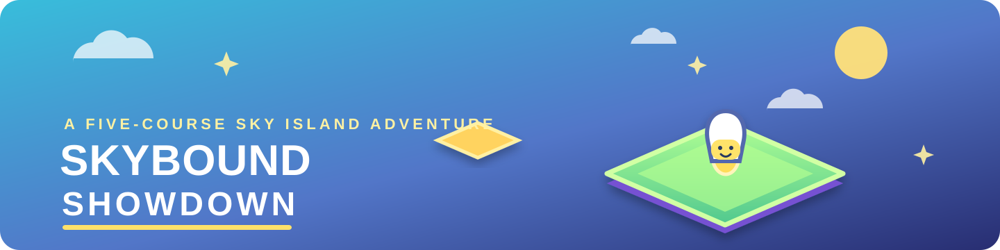

# Skybound Showdown

  

**Skybound Showdown** is a single-player 3D dimension-shifting platform adventure made with Godot 4.7. Run and double-jump across five sky-island obstacle courses, shifting between Material and Mirror dimensions to reveal alternate platforms and routes. The game features a variety of environmental hazards including bounce pads, fan tunnels, rolling barrels, and slippery/sticky zones. Collect every coin, activate the switch, and reach the finish flag.

## Play

1. Install [Godot 4.7 or later](https://godotengine.org/download/).
2. Clone or download this repository.
3. Open the root `project.godot` file in Godot.
4. Press **F6** to run the home screen, or **F5** to run the project.

The project starts on the home screen, where you can start the adventure, select any course, or view the controls.

## Courses

| # | Course | Route and challenge |
| --- | --- | --- |
| 1 | Cloud Hop | Spiral climb through floating sky hoops |
| 2 | Switchback Sprint | A broad S-shaped sprint with jump hurdles |
| 3 | Moonflip Maze | Tight turns through alternating wall openings |
| 4 | Rising Ruins | A steep climb framed by broken stone columns |
| 5 | Sky Crown | A long zigzag through golden gates to a crown of spires |

See [COURSES.md](COURSES.md) for course and mechanic notes.

## Controls

| Action | Keyboard / mouse | Controller |
| --- | --- | --- |
| Move | W, A, S, D | Left stick |
| Look around | Mouse movement | Right stick |
| Jump / double jump | Left click / Space | A |
| Shift dimension | Right click / Q | Left bumper (LB) |
| Freeze time briefly | F | Y |
| Activate a nearby switch | E | X |
| Zoom camera | Mouse wheel | Triggers |
| Navigate menus / select | Mouse click | D-pad or left stick / A |
| Return / back | Esc | B |

Each course requires collecting all coins, activating its switch, and touching the finish flag. Shift with **Q** between Material and Mirror dimensions; their platforms and selected hazards differ. Anti-gravity zones appear on selected courses; time freeze slows the whole game briefly and recharges after a cooldown.

Touch the yellow checkpoint beacons to save progress through a course. If you fall, you return to the latest beacon instead of restarting the level.

## Build and export

Open the project in Godot and use **Project → Export** to create a build for your platform. Godot's matching export templates must be installed first. The Godot editor can be downloaded for free; no additional game-specific tools are required.

## Credits and licenses

The game builds on Kenney's Starter Kit 3D Platformer. See [LICENSE.md](LICENSE.md) for the starter project's MIT license. Included models, sprites, and sound effects retain their original asset credits and licenses; the Lilita font license is in [fonts/license.txt](fonts/license.txt).
